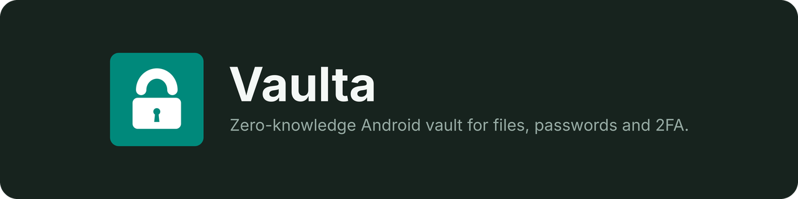
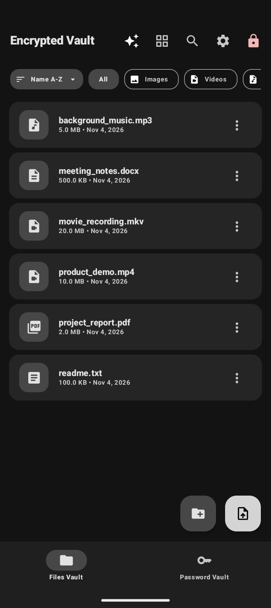
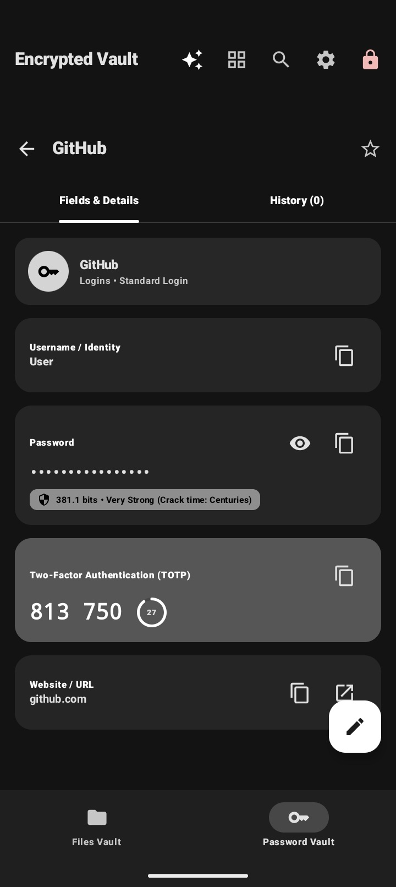
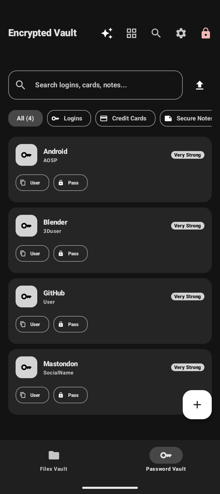
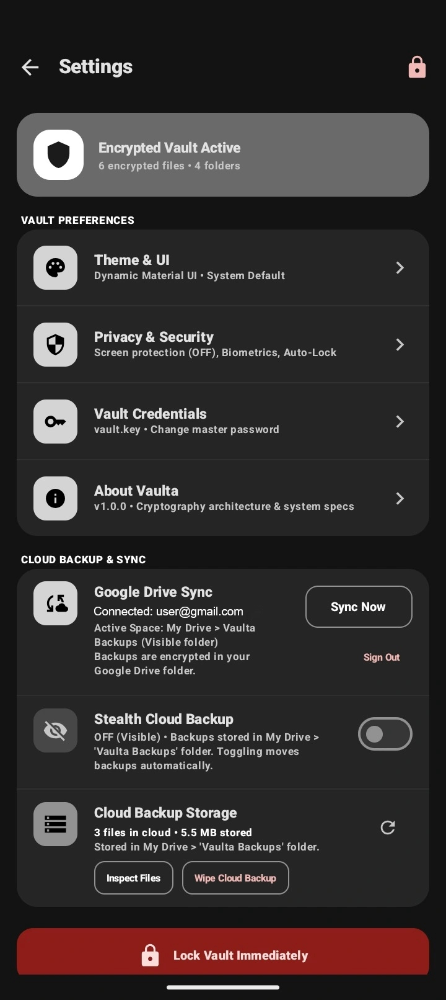

<div align="center">
  

  <p>Encrypted file storage, password management, and two-factor codes for Android.</p>

  <p>
    <a href="https://github.com/shrs425p/Vaulta/releases/latest">Downloads</a> ·
    <a href="https://vaultaaa.web.app">Website</a> ·
    <a href="https://github.com/shrs425p/Vaulta/issues">Issues</a> ·
    <a href="https://github.com/shrs425p/Vaulta/security/advisories">Security</a>
  </p>

  <p>
    
    
    <a href="LICENSE"></a>
  </p>
</div>

## Choose an edition

| | Offline | Cloud |
|---|---|---|
| **Use** | Local vault without app network access | Google Drive sync |
| **Package ID** | `com.vaulta.shrs.offline` | `com.vaulta.shrs` |
| **Download** | [Offline APK](https://github.com/shrs425p/Vaulta/releases/latest/download/app-offline-release.apk) | [Cloud APK](https://github.com/shrs425p/Vaulta/releases/latest/download/app-cloud-release.apk) |

The Offline APK omits Android's `INTERNET` and `ACCESS_NETWORK_STATE` permissions and the Cloud sync module. This limits Vaulta's own network access; Android, other apps, and document providers remain outside that boundary.

The Cloud edition encrypts file and index payloads before upload. Google and network providers can still observe account identity, requests, timing, approximate sizes, and storage metadata. Local-only items are not synchronized.

## Features

- Encrypted file vault and password manager
- TOTP/HOTP two-factor codes
- Vault recovery with a portable `vault.key` and recovery code
- Optional strong-biometric unlock through Android Keystore; StrongBox is used when available
- Auto-lock and clipboard-clearing settings
- In-app previews for supported images, text, tables, audio, and video
- Optional Google Drive sync in the separate Cloud edition

<details>
<summary>Screenshots</summary>

<p align="center">
  
  
  
  
</p>

</details>

## Security and data

Vaulta uses Argon2id for password-based key derivation, AES-256-GCM for authenticated encryption, and HKDF-SHA256 for per-file keys. File data is encrypted in authenticated chunks. Android vault operations fail closed if the native Argon2id implementation cannot load.

The local MobSF static scans of the 1.1.0 APKs reported no high-severity findings. Scanner scores are heuristic; this is not an independent security audit or certification. Full dynamic analysis and independent review remain outstanding. Read the [security review notes](SECURITY_AUDIT.md) and [community review request](https://github.com/shrs425p/Vaulta/issues/4).

A `vault.key` file alone is not a complete file-vault backup. See [Backup and recovery](docs/BACKUP_AND_RECOVERY.md) before moving devices or clearing app data.

Report suspected vulnerabilities through [GitHub Security Advisories](https://github.com/shrs425p/Vaulta/security/advisories/new). Please avoid posting exploit details in public issues.

## Cloud compatibility

Vaulta 1.1.0 writes encrypted file-stream format 3, which 1.0.0 clients cannot read. Update all Cloud devices before syncing files written by 1.1.0 between them.

## Build from source

Requirements: JDK 17 or later, Android SDK Platform 36, and Build Tools 36.0.0 or later.

```bash
git clone https://github.com/shrs425p/Vaulta.git
cd Vaulta
./gradlew --no-daemon test lintOfflineRelease lintCloudRelease assembleOfflineRelease assembleCloudRelease
```

The APKs are written under `app/build/outputs/apk/offline/release/` and `app/build/outputs/apk/cloud/release/`.

Verify a downloaded APK's signature with Android's `apksigner`:

```bash
apksigner verify --print-certs app-offline-release.apk
```

The release certificate SHA-256 fingerprint is:

```text
a51b31b9fa153c0a102acf49615af4666b6bf0cbc79175d329fb08db35ded269
```

See [CONTRIBUTING.md](CONTRIBUTING.md) for contribution guidance. Vaulta is licensed under the [Apache License 2.0](LICENSE).
